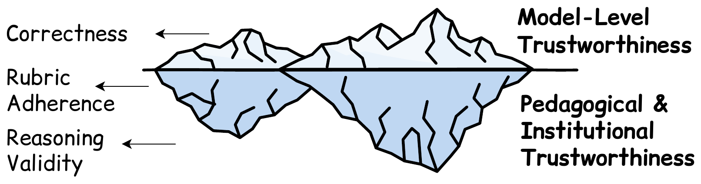
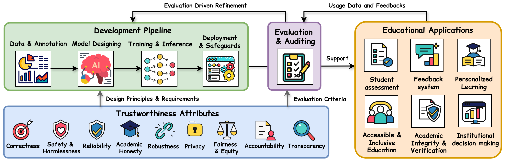
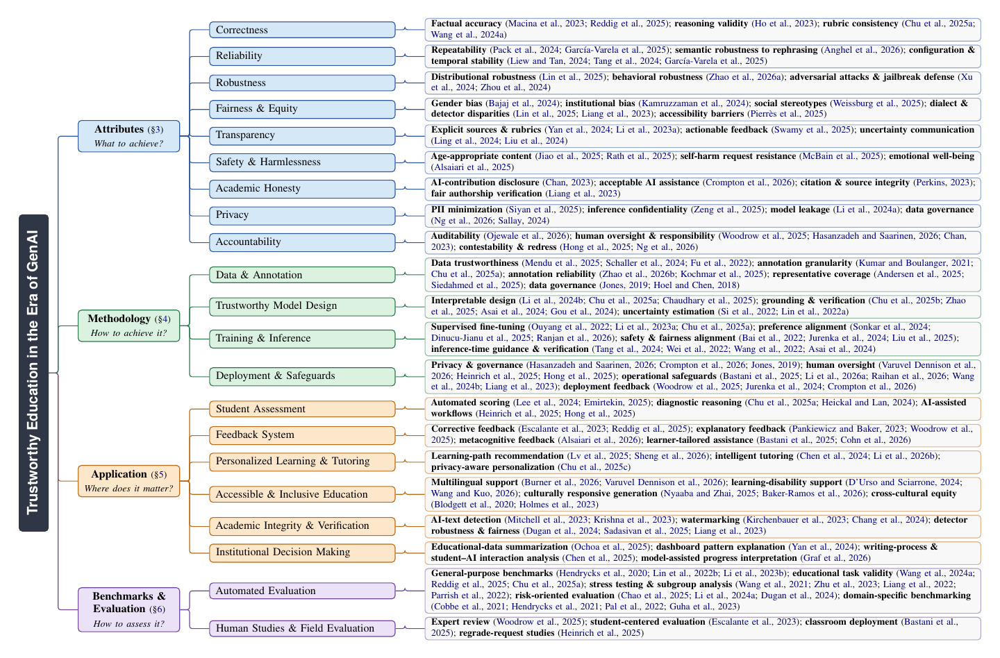

<div align="center">

# Awesome Trustworthy AI4Edu

**A curated list of papers on trustworthy generative AI (GenAI) for education**

[](https://awesome.re)


[](https://github.com/ChengshuaiZhao0/Awesome-Trustworthy-AI4Edu/pulls)


</div>

This repository accompanies our survey ***Trustworthy Education in the Era of Generative AI: A Survey*** and is organized along the same taxonomy.

> [!TIP]
> Missing a paper or spotted an error? [Open an issue](https://github.com/ChengshuaiZhao0/Awesome-Trustworthy-AI4Edu/issues) or submit a pull request (see [Contributing](#contributing)).

## News

- **[10/16/2026]** GitHub repository created with 147 papers organized by our survey's taxonomy. The survey will be available soon.

## Background



Generative AI is rapidly reshaping education, while raising growing concerns about the trustworthiness of AI-supported learning and decision-making.

In educational settings, trustworthiness extends beyond model behavior. Model-level properties such as correctness are only the tip of the iceberg; beneath the surface lie pedagogical and institutional requirements, such as rubric adherence and valid reasoning.

Existing research remains fragmented across trustworthiness concerns, technical methods, educational applications, and evaluation practices. The survey connects them through a **lifecycle perspective** and a **four-axis taxonomy**:

<br clear="right">

| Axis | Guiding Question | Scope |
|:--|:--|:--|
| [**Attributes**](#trustworthiness-attributes) | *What to achieve?* | Nine properties of trustworthy educational GenAI, from correctness to accountability |
| [**Methodology**](#trustworthiness-methodology) | *How to achieve it?* | Data and annotation, model design, training and inference, deployment and safeguards |
| [**Applications**](#trustworthy-educational-applications) | *Where does it matter?* | Assessment, feedback, tutoring, inclusive education, academic integrity, institutional decisions |
| [**Evaluation**](#benchmarks-and-evaluation) | *How to assess it?* | Educational benchmarks, automated evaluation, human and field studies |

## Lifecycle of Trustworthy Education

Trustworthiness requirements guide system development; evaluation and auditing verify whether they are met; educational applications reveal their practical implications; and evidence from evaluation and real-world use feeds back into refinement.

<p align="center">
  
  <br>
  <em>The lifecycle of trustworthy education in the era of GenAI.</em>
</p>

## Taxonomy

<p align="center">
  
  <br>
  <em>Taxonomy of trustworthy education in the era of GenAI, with representative work for each topic.</em>
</p>

## Contents

- [Trustworthiness Attributes](#trustworthiness-attributes)
  - [Correctness](#correctness) · [Reliability](#reliability) · [Robustness](#robustness) · [Fairness and Equity](#fairness-and-equity) · [Transparency](#transparency) · [Safety and Harmlessness](#safety-and-harmlessness) · [Academic Honesty](#academic-honesty) · [Privacy](#privacy) · [Accountability](#accountability)
- [Trustworthiness Methodology](#trustworthiness-methodology)
  - [Data and Annotation](#data-and-annotation) · [Trustworthy Model Design](#trustworthy-model-design) · [Training and Inference](#training-and-inference) · [Deployment and Safeguards](#deployment-and-safeguards)
- [Trustworthy Educational Applications](#trustworthy-educational-applications)
  - [Student Assessment](#student-assessment) · [Feedback Systems](#feedback-systems) · [Personalized Learning and Tutoring](#personalized-learning-and-tutoring) · [Accessible and Inclusive Education](#accessible-and-inclusive-education) · [Academic Integrity and Verification](#academic-integrity-and-verification) · [Institutional Decision Making](#institutional-decision-making)
- [Benchmarks and Evaluation](#benchmarks-and-evaluation)
  - [Educational Benchmarks](#educational-benchmarks) · [Automated Evaluation](#automated-evaluation) · [Human Studies and Field Evaluation](#human-studies-and-field-evaluation)
- [Citation](#citation)
- [Contributing](#contributing)

## Trustworthiness Attributes

*What to achieve?* The key properties expected of trustworthy educational GenAI.

### Correctness

Accuracy of AI-generated educational content, reasoning, and assessments: factual accuracy, reasoning validity, and rubric consistency.

- **Generating in-context, personalized feedback for intelligent tutors with large language models**. *International Journal of Artificial Intelligence in Education* 2025. [[paper]](https://doi.org/10.1007/s40593-025-00505-6)
- **Rationale behind essay scores: Enhancing S-LLM’s multi-trait essay scoring with rationale generated by LLMs**. *Findings of NAACL* 2025. [[paper]](https://doi.org/10.18653/v1/2025.findings-naacl.322)
- **Beyond agreement: Diagnosing the rationale alignment of automated essay scoring methods based on linguistically-informed counterfactuals**. *Findings of EMNLP* 2024. [[paper]](https://doi.org/10.18653/v1/2024.findings-emnlp.520)
- **Mathdial: A dialogue tutoring dataset with rich pedagogical properties grounded in math reasoning problems**. *Findings of EMNLP* 2023. [[paper]](https://doi.org/10.18653/v1/2023.findings-emnlp.372)
- **Large language models are reasoning teachers**. *ACL* 2023. [[paper]](https://aclanthology.org/2023.acl-long.830)

### Reliability

Stable and reproducible assessment outcomes: repeatability, semantic robustness to rephrasing, and configuration and temporal stability.

- **CreditTrace-LLM: Auditing Rubric-Point Responsiveness and Credit Locality in LLM-Based Automated Grading**. *Computers* 2026. [[paper]](https://doi.org/10.3390/computers15090571)
- **ChatGPT as a stable and fair tool for automated essay scoring**. *Education Sciences* 2025. [[paper]](https://doi.org/10.3390/educsci15080946)
- **Large language models and automated essay scoring of English language learner writing: Insights into validity and reliability**. *Computers and Education: Artificial Intelligence* 2024. [[paper]](https://doi.org/10.1016/j.caeai.2024.100234)
- **On automated essay grading using large language models**. *CSAI* 2024. [[paper]](https://doi.org/10.1145/3709026.3709030)
- **Harnessing LLMs for multi-dimensional writing assessment: Reliability and alignment with human judgments**. *Heliyon* 2024. [[paper]](https://doi.org/10.1016/j.heliyon.2024.e34262)

### Robustness

Appropriate educational behavior under uncommon or adversarial inputs: distributional and behavioral robustness, adversarial attacks, and jailbreak defense.

- **SHAPE: Unifying Safety, Helpfulness and Pedagogy for Educational LLMs**. *ACL* 2026. [[paper]](https://doi.org/10.18653/v1/2026.acl-long.529)
- **Assessing dialect fairness and robustness of large language models in reasoning tasks**. *ACL* 2025. [[paper]](https://doi.org/10.18653/v1/2025.acl-long.317)
- **An LLM can Fool Itself: A Prompt-Based Adversarial Attack**. *ICLR* 2024. [[paper]](https://arxiv.org/abs/2310.13345)
- **Robust prompt optimization for defending language models against jailbreaking attacks**. *NeurIPS* 2024. [[paper]](https://doi.org/10.52202/079017-1270)

### Fairness and Equity

Comparable opportunities and treatment for learners from different demographic, linguistic, socioeconomic, and accessibility backgrounds.

- **Llms are biased teachers: Evaluating llm bias in personalized education**. *Findings of NAACL* 2025. [[paper]](https://doi.org/10.18653/v1/2025.findings-naacl.314)
- **Exploring the role of generative AI in higher education: Semi-structured interviews with students with disabilities**. *Education and Information Technologies* 2025. [[paper]](https://doi.org/10.1007/s10639-024-13134-8)
- **Evaluating gender bias of LLMs in making morality judgements**. *Findings of EMNLP* 2024. [[paper]](https://doi.org/10.18653/v1/2024.findings-emnlp.928)
- **Investigating subtler biases in LLMs: Ageism, beauty, institutional, and nationality bias in generative models**. *Findings of ACL* 2024. [[paper]](https://doi.org/10.18653/v1/2024.findings-acl.530)

### Transparency

Making the basis, evidence, uncertainty, and limitations of GenAI outputs understandable to learners.

- **iLLuMinaTE: An LLM-XAI framework leveraging social science explanation theories towards actionable student performance feedback**. *AAAI* 2025. [[paper]](https://doi.org/10.1609/aaai.v39i27.35065)
- **VizChat: enhancing learning analytics dashboards with contextualised explanations using multimodal generative AI chatbots**. *AIED* 2024. [[paper]](https://doi.org/10.1007/978-3-031-64299-9_13)
- **Uncertainty quantification for in-context learning of large language models**. *NAACL* 2024. [[paper]](https://aclanthology.org/2024.naacl-long.184)
- **Can llms learn uncertainty on their own? expressing uncertainty effectively in a self-training manner**. *EMNLP* 2024. [[paper]](https://doi.org/10.18653/v1/2024.emnlp-main.1205)
- **Distilling ChatGPT for explainable automated student answer assessment**. *Findings of EMNLP* 2023. [[paper]](https://doi.org/10.18653/v1/2023.findings-emnlp.399)

### Safety and Harmlessness

Preventing physical, psychological, or developmental harm to learners, including age-appropriate content and emotionally appropriate feedback.

- **LLMs and childhood safety: Identifying risks and proposing a protection framework for safe child-LLM interaction**. *arXiv* 2025. [[paper]](https://arxiv.org/abs/2502.11242)
- **LLM safety for children**. *NAACL* 2025. [[paper]](https://arxiv.org/abs/2502.12552)
- **Evaluation of alignment between large language models and expert clinicians in suicide risk assessment**. *Psychiatric Services* 2025. [[paper]](https://doi.org/10.1176/appi.ps.20250086)
- **Emotionally enriched AI-generated feedback: Supporting student well-being without compromising learning**. *Computers & Education* 2025. [[paper]](https://doi.org/10.1016/j.compedu.2025.105363)

### Academic Honesty

Educational work that accurately reflects students' contributions, with GenAI assistance that follows academic norms.

- **Governing generative AI in higher education: A global Delphi study on policy and practice**. *International Journal of Educational Technology in Higher Education* 2026. [[paper]](https://doi.org/10.1186/s41239-026-00602-z)
- **A comprehensive AI policy education framework for university teaching and learning**. *International Journal of Educational Technology in Higher Education* 2023. [[paper]](https://doi.org/10.1186/s41239-023-00408-3)
- **Academic integrity considerations of AI large language models in the post-pandemic era: ChatGPT and beyond**. *Journal of University Teaching and Learning Practice* 2023. [[paper]](https://doi.org/10.53761/1.20.02.07)
- **GPT detectors are biased against non-native English writers**. *Patterns* 2023. [[paper]](https://doi.org/10.1016/j.patter.2023.100779)

### Privacy

Protecting learners' sensitive information throughout its collection, processing, storage, and use.

- **Understanding How University Guidelines Address Privacy and Security Issues of Generative AI in Academic Settings**. *Proceedings on Privacy Enhancing Technologies* 2026. [[paper]](https://doi.org/10.56553/popets-2026-0159)
- **Papillon: Privacy preservation from internet-based and local language model ensembles**. *NAACL* 2025. [[paper]](https://doi.org/10.18653/v1/2025.naacl-long.173)
- **Privacyrestore: Privacy-preserving inference in large language models via privacy removal and restoration**. *ACL* 2025. [[paper]](https://doi.org/10.18653/v1/2025.acl-long.532)
- **Privlm-bench: A multi-level privacy evaluation benchmark for language models**. *ACL* 2024. [[paper]](https://doi.org/10.18653/v1/2024.acl-long.4)
- **Vetting generative AI tools for use in schools**. *Future of Privacy Forum* 2024. [[paper]](https://fpf.org/wp-content/uploads/2024/10/Ed_AI_legal_compliance.pdf_FInal_OCT24.pdf)

### Accountability

AI-supported decisions that can be traced, reviewed, contested, and corrected: auditability, human oversight, and contestability.

- **Audit trails for accountability in large language models**. *arXiv* 2026. [[paper]](https://arxiv.org/abs/2601.20727)
- **LLM-Assisted assessment in GIS education: an empirical evaluation of opportunities and risks**. *Journal of Geography in Higher Education* 2026. [[paper]](https://doi.org/10.1080/03098265.2026.2699176)
- **Governing generative AI in higher education: A global Delphi study on policy and practice**. *International Journal of Educational Technology in Higher Education* 2026. [[paper]](https://doi.org/10.1186/s41239-026-00602-z)
- **Understanding How University Guidelines Address Privacy and Security Issues of Generative AI in Academic Settings**. *Proceedings on Privacy Enhancing Technologies* 2026. [[paper]](https://doi.org/10.56553/popets-2026-0159)
- **Improving Generative AI Student Feedback: Direct Preference Optimization with Teachers in the Loop**. *EDM* 2025. [[paper]](https://educationaldatamining.org/EDM2025/proceedings/2025.EDM.short-papers.166/index.html)
- **“My Grade is Wrong!”: A Contestable AI Framework for Interactive Feedback in Evaluating Student Essays**. *AIED* 2025. [[paper]](https://doi.org/10.1007/978-3-031-98462-4_4)
- **A comprehensive AI policy education framework for university teaching and learning**. *International Journal of Educational Technology in Higher Education* 2023. [[paper]](https://doi.org/10.1186/s41239-023-00408-3)

## Trustworthiness Methodology

*How to achieve it?* Approaches that build trustworthiness into each stage of system development and deployment.

### Data and Annotation

#### Data Trustworthiness

- **Assessing fairness in finetuned scoring models with demographically restricted training data**. *Assessing Writing* 2026. [[paper]](https://doi.org/10.1016/j.asw.2026.101032)
- **Towards safer pretraining: analyzing and filtering harmful content in webscale datasets for responsible LLMs**. *IJCAI* 2025. [[paper]](https://doi.org/10.24963/ijcai.2025/53)
- **Fairness in automated essay scoring: A comparative analysis of algorithms on German learner essays from secondary education**. *BEA Workshop* 2024. [[paper]](https://aclanthology.org/2024.bea-1.18)
- **Stable unlearnable example: Enhancing the robustness of unlearnable examples via stable error-minimizing noise**. *AAAI* 2024. [[paper]](https://doi.org/10.1609/aaai.v38i4.28169)
- **Robust unlearnable examples: Protecting data against adversarial learning**. *arXiv* 2022. [[paper]](https://arxiv.org/abs/2203.14533)

#### Annotation Granularity and Reliability

- **EduMARS: Can Vision-Language Models Grade Like Teachers? Benchmarking Multimodal, Rubric-Based Assessment on Chinese K-12 Answers**. *Findings of ACL* 2026. [[paper]](https://doi.org/10.18653/V1/2026.FINDINGS-ACL.466)
- **Rationale behind essay scores: Enhancing S-LLM’s multi-trait essay scoring with rationale generated by LLMs**. *Findings of NAACL* 2025. [[paper]](https://doi.org/10.18653/v1/2025.findings-naacl.322)
- **Findings of the BEA 2025 shared task on pedagogical ability assessment of AI-powered tutors**. *BEA Workshop* 2025. [[paper]](https://doi.org/10.18653/v1/2025.bea-1.77)
- **Algorithmic fairness in automatic short answer scoring**. *International Journal of Artificial Intelligence in Education* 2025. [[paper]](https://doi.org/10.1007/s40593-025-00495-5)
- **Nonstandard English and the Automated Scoring of Open-Ended Math Problems**. *EDM* 2025. [[paper]](https://educationaldatamining.org/EDM2025/proceedings/2025.EDM.long-papers.195/index.html)
- **Inclusive education with AI: Supporting special needs and tackling language barriers**. *AI and Ethics* 2025. [[paper]](https://doi.org/10.1007/s43681-025-00824-3)
- **Beyond agreement: Diagnosing the rationale alignment of automated essay scoring methods based on linguistically-informed counterfactuals**. *Findings of EMNLP* 2024. [[paper]](https://doi.org/10.18653/v1/2024.findings-emnlp.520)
- **LLM-based Code-Switched Text Generation for Grammatical Error Correction**. *EMNLP* 2024. [[paper]](https://doi.org/10.18653/V1/2024.EMNLP-MAIN.942)
- **Mathdial: A dialogue tutoring dataset with rich pedagogical properties grounded in math reasoning problems**. *Findings of EMNLP* 2023. [[paper]](https://doi.org/10.18653/v1/2023.findings-emnlp.372)
- **Automated essay scoring and the deep learning black box: How are rubric scores determined?**. *International Journal of Artificial Intelligence in Education* 2021. [[paper]](https://doi.org/10.1007/s40593-020-00211-5)
- **Learning analytics and higher education: A proposed model for establishing informed consent mechanisms to promote student privacy and autonomy**. *International Journal of Educational Technology in Higher Education* 2019. [[paper]](https://doi.org/10.1186/s41239-019-0155-0)
- **Privacy and data protection in learning analytics should be motivated by an educational maxim—towards a proposal**. *Research and Practice in Technology Enhanced Learning* 2018. [[paper]](https://doi.org/10.1186/s41039-018-0086-8)

### Trustworthy Model Design

#### Interpretable Model Design

- **SHAPE: Unifying Safety, Helpfulness and Pedagogy for Educational LLMs**. *ACL* 2026. [[paper]](https://doi.org/10.18653/v1/2026.acl-long.529)
- **REC-CBM: Rubric-Aware Error-Correction Concept Bottleneck Models for Trustworthy Open-Ended Grading**. *arXiv* 2026. [[paper]](https://arxiv.org/abs/2605.27402)
- **Rationale behind essay scores: Enhancing S-LLM’s multi-trait essay scoring with rationale generated by LLMs**. *Findings of NAACL* 2025. [[paper]](https://doi.org/10.18653/v1/2025.findings-naacl.322)
- **EssayCBM: Rubric-aligned concept bottleneck models for transparent essay grading**. *arXiv* 2025. [[paper]](https://arxiv.org/abs/2512.20817)
- **Calibrating LLMs with Preference Optimization on Thought Trees for Generating Rationale in Science Question Scoring**. *Findings of EMNLP* 2024. [[paper]](https://doi.org/10.18653/V1/2024.FINDINGS-EMNLP.313)

#### Grounding and Verification

- **Enhancing LLM-Based Short Answer Grading with Retrieval-Augmented Generation**. *EDM* 2025. [[paper]](https://educationaldatamining.org/EDM2025/proceedings/2025.EDM.short-papers.81/index.html)
- **MedTutor: a retrieval-augmented LLM system for case-based medical education**. *EMNLP* 2025. [[paper]](https://doi.org/10.18653/v1/2025.emnlp-demos.24)
- **Ontology-aware rag for improved question-answering in cybersecurity education**. *IEEE BigData* 2025. [[paper]](https://doi.org/10.1109/bigdata66926.2025.11401740)
- **CyberBOT: Ontology-Grounded Retrieval Augmented Generation for Reliable Cybersecurity Education**. *CIKM* 2025. [[paper]](https://doi.org/10.1145/3746252.3761478)
- **Retrieval-augmented Generation to Improve Math Question-Answering: Trade-offs Between Groundedness and Human Preference**. *EDM* 2024. [[paper]](https://educationaldatamining.org/edm2024/proceedings/2024.EDM-short-papers.28/index.html)
- **Self-rag: Learning to retrieve, generate, and critique through self-reflection**. *ICLR* 2024. [[paper]](https://arxiv.org/abs/2310.11511)
- **Critic: Large language models can self-correct with tool-interactive critiquing**. *ICLR* 2024. [[paper]](https://arxiv.org/abs/2305.11738)
- **Toolformer: Language models can teach themselves to use tools**. *NeurIPS* 2023. [[paper]](https://doi.org/10.52202/075280-2997)

#### Uncertainty Estimation

- **Prompting gpt-3 to be reliable**. *arXiv* 2022. [[paper]](https://arxiv.org/abs/2210.09150)
- **Teaching models to express their uncertainty in words**. *arXiv* 2022. [[paper]](https://arxiv.org/abs/2205.14334)

### Training and Inference

#### Training-Time Alignment

- **PERSA: Reinforcement Learning for Professor-Style Personalized Feedback with LLMs**. *arXiv* 2026. [[paper]](https://arxiv.org/abs/2605.01123)
- **Rationale behind essay scores: Enhancing S-LLM’s multi-trait essay scoring with rationale generated by LLMs**. *Findings of NAACL* 2025. [[paper]](https://doi.org/10.18653/v1/2025.findings-naacl.322)
- **From problem-solving to teaching problem-solving: Aligning llms with pedagogy using reinforcement learning**. *EMNLP* 2025. [[paper]](https://doi.org/10.18653/v1/2025.emnlp-main.15)
- **Exploring Fairness and Explainability in LLM-Generated Support for Online Learning Discussion Forums**. *Journal of Learning Analytics* 2025. [[paper]](https://doi.org/10.18608/jla.2025.8885)
- **Pedagogical alignment of large language models**. *Findings of EMNLP* 2024. [[paper]](https://doi.org/10.18653/v1/2024.findings-emnlp.797)
- **Towards responsible development of generative AI for education: An evaluation-driven approach**. *arXiv* 2024. [[paper]](https://arxiv.org/abs/2407.12687)
- **Distilling ChatGPT for explainable automated student answer assessment**. *Findings of EMNLP* 2023. [[paper]](https://doi.org/10.18653/v1/2023.findings-emnlp.399)
- **Fine-grained human feedback gives better rewards for language model training**. *NeurIPS* 2023. [[paper]](https://doi.org/10.52202/075280-2574)
- **Raft: Reward ranked finetuning for generative foundation model alignment**. *arXiv* 2023. [[paper]](https://arxiv.org/abs/2304.06767)
- **Training language models to follow instructions with human feedback**. *NeurIPS* 2022. [[paper]](https://doi.org/10.52202/068431-2011)
- **Constitutional ai: Harmlessness from ai feedback**. *arXiv* 2022. [[paper]](https://arxiv.org/abs/2212.08073)

#### Inference-Time Guidance

- **Harnessing LLMs for multi-dimensional writing assessment: Reliability and alignment with human judgments**. *Heliyon* 2024. [[paper]](https://doi.org/10.1016/j.heliyon.2024.e34262)
- **Self-rag: Learning to retrieve, generate, and critique through self-reflection**. *ICLR* 2024. [[paper]](https://arxiv.org/abs/2310.11511)
- **Chain-of-thought prompting elicits reasoning in large language models**. *NeurIPS* 2022. [[paper]](https://doi.org/10.52202/068431-1800)
- **Large language models are zero-shot reasoners**. *NeurIPS* 2022. [[paper]](https://doi.org/10.52202/068431-1613)
- **Self-consistency improves chain of thought reasoning in language models**. *arXiv* 2022. [[paper]](https://arxiv.org/abs/2203.11171)
- **Prompting gpt-3 to be reliable**. *arXiv* 2022. [[paper]](https://arxiv.org/abs/2210.09150)

### Deployment and Safeguards

#### Privacy and Governance

- **LLM-Assisted assessment in GIS education: an empirical evaluation of opportunities and risks**. *Journal of Geography in Higher Education* 2026. [[paper]](https://doi.org/10.1080/03098265.2026.2699176)
- **Governing generative AI in higher education: A global Delphi study on policy and practice**. *International Journal of Educational Technology in Higher Education* 2026. [[paper]](https://doi.org/10.1186/s41239-026-00602-z)
- **Learning analytics and higher education: A proposed model for establishing informed consent mechanisms to promote student privacy and autonomy**. *International Journal of Educational Technology in Higher Education* 2019. [[paper]](https://doi.org/10.1186/s41239-019-0155-0)
- **Privacy and data protection in learning analytics should be motivated by an educational maxim—towards a proposal**. *Research and Practice in Technology Enhanced Learning* 2018. [[paper]](https://doi.org/10.1186/s41039-018-0086-8)

#### Human Oversight and Operational Safeguards

- **Shiksha Copilot: Teacher-AI Collaboration for Curating and Customizing Lesson Plans in Low-Resource Schools**. *PACM HCI* 2026. [[paper]](https://doi.org/10.1145/3788074)
- **VETTING: A dual-LLM framework for in-loop safety verification via policy isolation in educational AI**. *Computers and Education: Artificial Intelligence* 2026. [[paper]](https://doi.org/10.1016/j.caeai.2026.100646)
- **CodeGuard: Improving LLM Guardrails in CS Education**. *Findings of EACL* 2026. [[paper]](https://doi.org/10.18653/v1/2026.findings-eacl.48)
- **AI-assisted grading and personalized feedback in large political science classes: Results from randomized controlled trials**. *PLOS ONE* 2025. [[paper]](https://doi.org/10.1371/journal.pone.0328041)
- **“My Grade is Wrong!”: A Contestable AI Framework for Interactive Feedback in Evaluating Student Essays**. *AIED* 2025. [[paper]](https://doi.org/10.1007/978-3-031-98462-4_4)
- **Generative AI without guardrails can harm learning: Evidence from high school mathematics**. *PNAS* 2025. [[paper]](https://doi.org/10.1073/pnas.2422633122)
- **Aegis2. 0: A diverse ai safety dataset and risks taxonomy for alignment of llm guardrails**. *NAACL* 2025. [[paper]](https://doi.org/10.18653/v1/2025.naacl-long.306)
- **M4: Multi-generator, multi-domain, and multi-lingual black-box machine-generated text detection**. *EACL* 2024. [[paper]](https://doi.org/10.18653/v1/2024.eacl-long.83)
- **GPT detectors are biased against non-native English writers**. *Patterns* 2023. [[paper]](https://doi.org/10.1016/j.patter.2023.100779)

#### Deployment Feedback

- **Governing generative AI in higher education: A global Delphi study on policy and practice**. *International Journal of Educational Technology in Higher Education* 2026. [[paper]](https://doi.org/10.1186/s41239-026-00602-z)
- **Improving Generative AI Student Feedback: Direct Preference Optimization with Teachers in the Loop**. *EDM* 2025. [[paper]](https://educationaldatamining.org/EDM2025/proceedings/2025.EDM.short-papers.166/index.html)
- **Towards responsible development of generative AI for education: An evaluation-driven approach**. *arXiv* 2024. [[paper]](https://arxiv.org/abs/2407.12687)

## Trustworthy Educational Applications

*Where does it matter?* Trustworthiness in real-world educational use cases.

### Student Assessment

- **Large language model-powered automated assessment: A systematic review**. *Applied Sciences* 2025. [[paper]](https://doi.org/10.3390/app15105683)
- **Rationale behind essay scores: Enhancing S-LLM’s multi-trait essay scoring with rationale generated by LLMs**. *Findings of NAACL* 2025. [[paper]](https://doi.org/10.18653/v1/2025.findings-naacl.322)
- **AI-assisted grading and personalized feedback in large political science classes: Results from randomized controlled trials**. *PLOS ONE* 2025. [[paper]](https://doi.org/10.1371/journal.pone.0328041)
- **“My Grade is Wrong!”: A Contestable AI Framework for Interactive Feedback in Evaluating Student Essays**. *AIED* 2025. [[paper]](https://doi.org/10.1007/978-3-031-98462-4_4)
- **Unleashing large language models’ proficiency in zero-shot essay scoring**. *Findings of EMNLP* 2024. [[paper]](https://doi.org/10.18653/v1/2024.findings-emnlp.10)
- **Generating feedback-ladders for logical errors in programming using large language models**. *arXiv* 2024. [[paper]](https://arxiv.org/abs/2405.00302)

### Feedback Systems

- **Directive, metacognitive, or a blend of both? A comparison of AI-generated feedback types on student engagement, confidence, and outcomes**. *Computers and Education: Artificial Intelligence* 2026. [[paper]](https://doi.org/10.1016/j.caeai.2026.100553)
- **A theory of adaptive scaffolding for LLM-based pedagogical agents**. *AAAI* 2026. [[paper]](https://doi.org/10.1609/aaai.v40i3.37154)
- **Unraveling the mechanisms and effectiveness of AI-assisted feedback in education: A systematic literature review**. *Computers and Education Open* 2025. [[paper]](https://doi.org/10.1016/j.caeo.2025.100284)
- **Generating in-context, personalized feedback for intelligent tutors with large language models**. *International Journal of Artificial Intelligence in Education* 2025. [[paper]](https://doi.org/10.1007/s40593-025-00505-6)
- **Improving Generative AI Student Feedback: Direct Preference Optimization with Teachers in the Loop**. *EDM* 2025. [[paper]](https://educationaldatamining.org/EDM2025/proceedings/2025.EDM.short-papers.166/index.html)
- **Generative AI without guardrails can harm learning: Evidence from high school mathematics**. *PNAS* 2025. [[paper]](https://doi.org/10.1073/pnas.2422633122)
- **AI-generated feedback on writing: Insights into efficacy and ENL student preference**. *International Journal of Educational Technology in Higher Education* 2023. [[paper]](https://doi.org/10.1186/s41239-023-00425-2)
- **Large Language Models (GPT) for automating feedback on programming assignments**. *arXiv* 2023. [[paper]](https://arxiv.org/abs/2307.00150)

### Personalized Learning and Tutoring

- **LearnerCoMPASS: Intelligent Tutoring System with Dynamic Cognitive Diagnosis and Multi-Model Path Planning**. *ACL* 2026. [[paper]](https://doi.org/10.18653/v1/2026.acl-long.408)
- **LongTutor: Benchmarking Large Language Models for Long-term Personalized Tutoring**. *ACL* 2026. [[paper]](https://doi.org/10.18653/v1/2026.acl-long.1371)
- **Genal: Generative agent for adaptive learning**. *AAAI* 2025. [[paper]](https://doi.org/10.1609/aaai.v39i1.32038)
- **LLM Agents for Education: Advances and Applications**. *Findings of EMNLP* 2025. [[paper]](https://doi.org/10.18653/v1/2025.findings-emnlp.743)
- **Empowering private tutoring by chaining large language models**. *CIKM* 2024. [[paper]](https://doi.org/10.1145/3627673.3679665)

### Accessible and Inclusive Education

- **Students’ Use of an AI Translation Tool in Multilingual Classrooms**. *Education Sciences* 2026. [[paper]](https://doi.org/10.3390/educsci16060942)
- **Shiksha Copilot: Teacher-AI Collaboration for Curating and Customizing Lesson Plans in Low-Resource Schools**. *PACM HCI* 2026. [[paper]](https://doi.org/10.1145/3788074)
- **AI Chatbots and Dyslexia: How AI Chatbots Empower Students With Dyslexia to Master Arithmetic Word Problems**. *Journal of Learning Disabilities* 2026. [[paper]](https://doi.org/10.1177/00222194261450136)
- **Kumu Connect: Culturally-Authentic AI Tools to Enable Educator Agency and Data Sovereignty for Hawaiian K-12 CS Education**. *IDC* 2026. [[paper]](https://doi.org/10.1145/3773077.3806104)
- **Developing a theory-grounded AI tool for the generation of culturally responsive lesson plans**. *Computers and Education: Artificial Intelligence* 2025. [[paper]](https://doi.org/10.1016/j.caeai.2025.100474)
- **AI4LA: An intelligent chatbot for supporting students with dyslexia, based on generative AI**. *ITS* 2024. [[paper]](https://doi.org/10.1007/978-3-031-63028-6_31)
- **Guidance for generative AI in education and research**. *UNESCO* 2023. [[paper]](https://doi.org/10.54675/ewzm9535)
- **Language (technology) is power: A critical survey of “bias” in NLP**. *ACL* 2020. [[paper]](https://doi.org/10.18653/v1/2020.acl-main.485)

### Academic Integrity and Verification

- **Can AI-generated text be reliably detected? Stress testing AI text detectors under various attacks**. *TMLR* 2025. [[paper]](https://arxiv.org/abs/2303.11156)
- **Chatting and cheating: Ensuring academic integrity in the era of ChatGPT**. *Innovations in Education and Teaching International* 2024. [[paper]](https://doi.org/10.1080/14703297.2023.2190148)
- **Postmark: A robust blackbox watermark for large language models**. *EMNLP* 2024. [[paper]](https://doi.org/10.18653/v1/2024.emnlp-main.506)
- **Raid: A shared benchmark for robust evaluation of machine-generated text detectors**. *ACL* 2024. [[paper]](https://doi.org/10.18653/v1/2024.acl-long.674)
- **Academic integrity considerations of AI large language models in the post-pandemic era: ChatGPT and beyond**. *Journal of University Teaching and Learning Practice* 2023. [[paper]](https://doi.org/10.53761/1.20.02.07)
- **Detectgpt: Zero-shot machine-generated text detection using probability curvature**. *ICML* 2023. [[paper]](https://arxiv.org/abs/2301.11305)
- **Paraphrasing evades detectors of ai-generated text, but retrieval is an effective defense**. *NeurIPS* 2023. [[paper]](https://doi.org/10.52202/075280-1195)
- **A watermark for large language models**. *ICML* 2023. [[paper]](https://arxiv.org/abs/2301.10226)
- **GPT detectors are biased against non-native English writers**. *Patterns* 2023. [[paper]](https://doi.org/10.1016/j.patter.2023.100779)

### Institutional Decision Making

- **Interactive learning dashboards: rethinking learning visualisations as engagement tools**. *Education and Information Technologies* 2026. [[paper]](https://doi.org/10.1007/s10639-026-14082-1)
- **Exploring the potential of generative AI to support non-experts in learning analytics practice**. *Journal of Learning Analytics* 2025. [[paper]](https://doi.org/10.18608/jla.2025.8615)
- **Can theory-driven learning analytics dashboard enhance human-AI collaboration in writing learning? Insights from an empirical experiment**. *The Internet and Higher Education* 2025. [[paper]](https://doi.org/10.1016/j.iheduc.2025.101054)
- **VizChat: enhancing learning analytics dashboards with contextualised explanations using multimodal generative AI chatbots**. *AIED* 2024. [[paper]](https://doi.org/10.1007/978-3-031-64299-9_13)

## Benchmarks and Evaluation

*How to assess it?* Measuring and validating trustworthiness through automated benchmarks and real-world human studies.

### Educational Benchmarks

Benchmarks and evaluation resources for educational GenAI, with the trust attributes each one evaluates.

| Group | Benchmark | Evaluation Focus | Attributes |
|:--|:--|:--|:--|
| Education-specific | [EduBench](https://doi.org/10.18653/v1/2026.acl-long.987) | Multidisciplinary educational tasks | Correctness, Reliability |
| Education-specific | [K-12EduBench](https://doi.org/10.1609/aaai.v40i40.40744) | K–12 knowledge and educational goals | Correctness |
| Education-specific | [TutorBench](https://arxiv.org/abs/2510.02663) | Multimodal rubric-based STEM tutoring | Correctness, Transparency |
| Education-specific | [MRBench](https://doi.org/10.18653/v1/2025.naacl-long.57) | Mathematical mistake remediation | Correctness, Transparency |
| Education-specific | [MathTutorBench](https://doi.org/10.18653/v1/2025.emnlp-main.11) | Mathematical tutoring and scaffolding | Correctness |
| Education-specific | [LongTutor](https://doi.org/10.18653/v1/2026.acl-long.1371) | Long-term personalized tutoring | Correctness |
| Education-specific | [EduFair-Bench](https://arxiv.org/abs/2609.12949) | Demographic fairness in STEM tutoring | Fairness |
| Education-specific | [CASTLE](https://arxiv.org/abs/2602.05633) | Student-tailored educational safety | Fairness, Safety |
| Education-specific | [EduZone](https://arxiv.org/abs/2608.02024) | K–12 conversational safety | Safety |
| Education-specific | [EduGuardBench](https://doi.org/10.1609/aaai.v40i37.40399) | Adversarial misuse of LLMs as teachers | Academic Honesty |
| Assessment | [GSM8K](https://arxiv.org/abs/2110.14168) | Grade-school mathematical reasoning | Correctness |
| Assessment | [SciBench](https://arxiv.org/abs/2307.10635) | College math, physics, and chemistry | Correctness |
| Assessment | [DREsS](https://doi.org/10.18653/v1/2025.acl-long.659) | Rubric-based EFL essay scoring | Correctness |
| Assessment | [ASAP++](https://aclanthology.org/L18-1187) | Trait-specific essay scoring | Correctness |
| Assessment | [ASAP 2.0](https://doi.org/10.1016/j.asw.2025.100954) | Source-based writing assessment | Correctness, Fairness |
| Assessment | [SciEntsBank & Beetle](https://aclanthology.org/S13-2045) | Science and electricity short-answer assessment | Correctness, Robustness |
| Adjacent | [Safe-Child-LLM](https://arxiv.org/abs/2506.13510) | Child and adolescent interaction safety | Safety |
| Adjacent | [ChildSafe](https://arxiv.org/abs/2510.05484) | Development-sensitive child safety | Safety |
| Adjacent | [KIDBench](https://arxiv.org/abs/2605.25510) | Child-facing conversational safety | Robustness, Safety |
| Adjacent | [YAIR](https://doi.org/10.1145/3719027.3765168) | Youth-specific conversational risks | Safety |
| Adjacent | [SafeSciBench](https://arxiv.org/abs/2603.01589) | Scientific safety knowledge and risk | Safety |
| Adjacent | [PrivLM-Bench](https://doi.org/10.18653/v1/2024.acl-long.4) | Training and inference data privacy | Privacy |

### Automated Evaluation

#### General-Purpose and Education-Specific Evaluation

- **Generating in-context, personalized feedback for intelligent tutors with large language models**. *International Journal of Artificial Intelligence in Education* 2025. [[paper]](https://doi.org/10.1007/s40593-025-00505-6)
- **Rationale behind essay scores: Enhancing S-LLM’s multi-trait essay scoring with rationale generated by LLMs**. *Findings of NAACL* 2025. [[paper]](https://doi.org/10.18653/v1/2025.findings-naacl.322)
- **Beyond agreement: Diagnosing the rationale alignment of automated essay scoring methods based on linguistically-informed counterfactuals**. *Findings of EMNLP* 2024. [[paper]](https://doi.org/10.18653/v1/2024.findings-emnlp.520)
- **Halueval: A large-scale hallucination evaluation benchmark for large language models**. *EMNLP* 2023. [[paper]](https://doi.org/10.18653/v1/2023.emnlp-main.397)
- **Truthfulqa: Measuring how models mimic human falsehoods**. *ACL* 2022. [[paper]](https://doi.org/10.18653/v1/2022.acl-long.229)
- **Measuring massive multitask language understanding**. *arXiv* 2020. [[paper]](https://arxiv.org/abs/2009.03300)

#### Stress Testing and Subgroup Analysis

- **Promptrobust: Towards evaluating the robustness of large language models on adversarial prompts**. *LAMPS Workshop* 2023. [[paper]](https://doi.org/10.1145/3689217.3690621)
- **Holistic evaluation of language models**. *arXiv* 2022. [[paper]](https://arxiv.org/abs/2211.09110)
- **BBQ: A hand-built bias benchmark for question answering**. *Findings of ACL* 2022. [[paper]](https://doi.org/10.18653/v1/2022.findings-acl.165)
- **Adversarial glue: A multi-task benchmark for robustness evaluation of language models**. *arXiv* 2021. [[paper]](https://arxiv.org/abs/2111.02840)

#### Risk-Oriented Evaluation

- **Jailbreaking black box large language models in twenty queries**. *SaTML* 2025. [[paper]](https://doi.org/10.1109/satml64287.2025.00010)
- **Privlm-bench: A multi-level privacy evaluation benchmark for language models**. *ACL* 2024. [[paper]](https://doi.org/10.18653/v1/2024.acl-long.4)
- **Raid: A shared benchmark for robust evaluation of machine-generated text detectors**. *ACL* 2024. [[paper]](https://doi.org/10.18653/v1/2024.acl-long.674)
- **Paraphrasing evades detectors of ai-generated text, but retrieval is an effective defense**. *NeurIPS* 2023. [[paper]](https://doi.org/10.52202/075280-1195)

#### Domain-Specific Benchmarking

- **Legalbench: A collaboratively built benchmark for measuring legal reasoning in large language models**. *NeurIPS* 2023. [[paper]](https://doi.org/10.52202/075280-1915)
- **Medmcqa: A large-scale multi-subject multi-choice dataset for medical domain question answering**. *CHIL* 2022. [[paper]](https://arxiv.org/abs/2203.14371)
- **Training verifiers to solve math word problems**. *arXiv* 2021. [[paper]](https://arxiv.org/abs/2110.14168)
- **Measuring mathematical problem solving with the math dataset**. *arXiv* 2021. [[paper]](https://arxiv.org/abs/2103.03874)

### Human Studies and Field Evaluation

#### Expert and User Evaluation

- **Improving Generative AI Student Feedback: Direct Preference Optimization with Teachers in the Loop**. *EDM* 2025. [[paper]](https://educationaldatamining.org/EDM2025/proceedings/2025.EDM.short-papers.166/index.html)
- **AI-generated feedback on writing: Insights into efficacy and ENL student preference**. *International Journal of Educational Technology in Higher Education* 2023. [[paper]](https://doi.org/10.1186/s41239-023-00425-2)

#### Classroom and Field Studies

- **Generative AI without guardrails can harm learning: Evidence from high school mathematics**. *PNAS* 2025. [[paper]](https://doi.org/10.1073/pnas.2422633122)
- **AI-assisted grading and personalized feedback in large political science classes: Results from randomized controlled trials**. *PLOS ONE* 2025. [[paper]](https://doi.org/10.1371/journal.pone.0328041)
- **AI-generated feedback on writing: Insights into efficacy and ENL student preference**. *International Journal of Educational Technology in Higher Education* 2023. [[paper]](https://doi.org/10.1186/s41239-023-00425-2)

## Citation

If this repository or our survey supports your research, we would appreciate a citation:

```bibtex
@article{zhao2026trustworthy,
  title   = {Trustworthy Education in the Era of Generative AI: A Survey},
  author  = {Zhao, Chengshuai and Liu, Ziyan and Chaudhary, Kumar Satvik and Ting, Lo Pang-Yun and Liu, Huan},
  year    = {2026}
}
```

## Contributing

Contributions are welcome. To add a paper, open an issue or a pull request with the entry in this format, placed under the most relevant section:

```markdown
- **Paper Title**. *Venue* Year. [[paper]](link)
```
